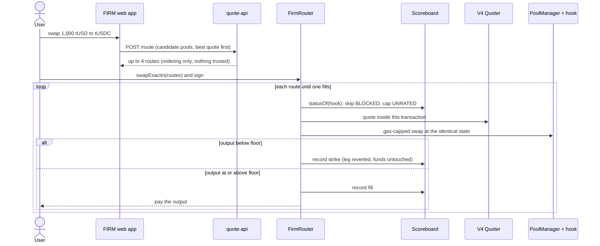

<div align="center">



# FIRM

**Your quote is a promise.**

A Uniswap v4 router for Monad that checks every pool's quote against its real fill inside the same transaction, strikes hooks that lie on a public Scoreboard, and falls back to an honest pool.

[**Live app**](https://firm-gold.vercel.app) · [Demo](#demo) · [How it works](#how-it-works) · [Run it locally](#run-it-locally) · [Deployments](docs/DEPLOYMENTS.md) · [Results](docs/RESULTS.md) · [Docs](#documentation)


</div>

---
## What it is

When you swap tokens, an app shows a quote such as "you will receive about 999 USDC". On Uniswap v4 a pool can attach a **hook**: a contract that runs during the swap and can change the amounts. A badly behaved hook can look good in the quote and take a hidden fee when the swap really executes. Nothing in today's routers remembers which hooks did that, so the next user is hit too.

**FIRM** turns the quote into a promise:

1. For every swap it asks the pool's V4 Quoter for a quote **inside the same transaction**, then executes at the identical state.
2. If the settled output is below the floor, FIRM reverts only that leg (the user's funds are untouched), writes a **public strike** against the hook, and falls back to the next pool.
3. A separate **canary** probes hooks with dust swaps from several sender identities before users arrive.
4. Everything lands in an onchain **Scoreboard** that any other router can read.

Inside one transaction the pool's state cannot change except through the pool and its hook, so any difference between the quoted and the settled amount is caused by the hook, not by the market. No oracle, no CEX price, no dispute process.

> A router that only trusts quotes cannot tell an expensive pool from a lying one. FIRM keeps a public record of which hooks kept their promise, so the lesson is learned once for everyone.

Built for the **Monad Metropolis** hackathon, **Track 1: Onchain Finance and Trading**, on **Monad Testnet (chain 10143)**. Solo builder: Thameemul Azarudeen.

## Demo

- **Live app:** <https://firm-gold.vercel.app> (Monad Testnet; connect any injected wallet such as MetaMask, the button switches the network for you)
- **Demo video (under 3 minutes):** linked in the hackathon submission form. It shows the real product with real testnet transactions, not slides.
- **Pitch page:** <https://firm-gold.vercel.app/pitch> · **Business case:** <https://firm-gold.vercel.app/business>
- **Walkthrough script and judge flow:** [docs/DEMO.md](docs/DEMO.md)
- **Try it:** press *Mint test tokens*, open **Swap**, send 1,000 tUSD through **Raw** and then through **Protected**, and compare the two receipts.

### The same trade, two routers

Measured on the **public Monad Testnet** with our own seeded pools and misbehaving hooks (test fixtures, see [Known limits](#known-limits)):

| Pool | Quote | What really happens |
|---|---|---|
| B: context-spoofing hook | 999.0 (best) | about 18% hidden fee, 819.2 delivered |
| C: honest hook | 998.2 | delivers 998.2 |
| A: no hook | 997.5 | delivers 997.5 |

A naive router picks B and receives **819.18**. FIRM quotes B, executes, sees the shortfall, reverts that leg, strikes B (now `BLOCKED` for every router) and fills C: **998.20**, about 179 tokens saved.

| Run | Unprotected router | Through FIRM |
|---|---|---|
| 11 Oct 2026, `DemoSwap.s.sol` | [`0xe69c7626...`](https://testnet.monadexplorer.com/tx/0xe69c7626a9133a6de05adab2e06bbfe6bdef8d54648c76a0b38b216548758627): 819.1792 | [`0xbacac567...`](https://testnet.monadexplorer.com/tx/0xbacac567bba50277b376148e21d33ce813ed3b2366d8db2a889885d730a2591e): Pool B rejected at 1,799 bps and BLOCKED, Pool C filled 998.1997 |
| 13 Oct 2026, through the web app in a real browser with MetaMask (the demo video) | [`0xb696b7e7...`](https://testnet.monadexplorer.com/tx/0xb696b7e71d971d35c57880a4b08b8d58ffaf0dad605b72b30d555ac4c172b260): about 819.2 | [`0xe38edb07...`](https://testnet.monadexplorer.com/tx/0xe38edb07a10a8277948be70e0ac70df5d591b9ff7a73107505291fb2777723d8): the gas-grief Pool G (ranked first) struck and BLOCKED, Pool C filled about 998.2, gas limit 1,368,774 |

One trade each, not the 20-trade benchmark. Pools B and G are now `BLOCKED` on the live Scoreboard, so a fresh run of the same route will skip them.

## How it works



| Step | What happens |
|---|---|
| **1. Candidates** | The caller passes up to 4 routes, best quote first, from `quote-api` (ordering only; FirmRouter re-quotes and re-checks everything onchain). |
| **2. Scoreboard check** | Skip `BLOCKED` hooks and cap `UNRATED` ones. |
| **3. In-transaction quote** | The V4 Quoter is called inside the swap transaction and `floor = quote - tolerance`. |
| **4. Gas-capped execution** | The swap runs in a self-call that reverts if output is below the floor, carrying the settled amount in the revert data. |
| **5. Strike** | On a shortfall (or any failure after a good quote) the strike is written in the outer frame and the router moves on. The swap itself was undone. |
| **6. Settle** | On success it pays the user and records the fill. If every route fails it refunds the input and returns normally, so the strikes persist. |

An optional `advertisedOut` per route (the off-chain quote) additionally skips a hook that quotes differently to an `eth_call` than inside a transaction.

### The canary

`CanaryRunner` swaps dust through `ProbeSender` contracts at several deterministic addresses, so a hook that is honest only to routers it recognises is caught before users arrive. Probe recognition is an arms race and is **not** solved (see limits). In our live run the honest hook took 24 clean probes with 0 strikes, and the five misbehaving fixture hooks were blocked in 1 to 3 probes.

### The agent showcase

- **Swap by message** (`/agent`): write *"swap 250 tUSD to tUSDC and send it to 0x..."*. A language model proposes the order, fixed code validates it against your text, FIRM quotes every pool, and **your own wallet signs**. The agent never holds keys.
- **MCP tool server** (`backend/firm-mcp`): an AI agent gets one swap tool, `firm_swap`, that always goes through the check. A trader agent (`backend/trader-agent`) drives it with an LLM (Groq: `openai/gpt-oss-120b`, `qwen/qwen3.8-27b`) or a scripted fallback.

## Safety model

Contracts make every fund and status decision. The indexer is display only. `quote-api` only orders candidates. An LLM, if configured, only writes prose or drives a demo agent whose one swap tool is `firm_swap`; **a model output can never move funds by itself.**

- **Quote and fill compared in one transaction.** A difference can only come from the pool or its hook.
- **Only the leg reverts.** A strike is recorded in the outer frame, so it survives the reverted swap, and the user's input is refunded exactly if every route fails.
- **Gas-capped legs.** A hook that reverts or burns gas hits a per-leg cap and cannot stop the swap. A failure is blamed on the hook only when the call had its full gas, so low gas can never strike or skip an honest hook.
- **Public, shared status.** `UNRATED`, `NORMAL`, `WATCH` or `BLOCKED` per hook, readable by any router with two calls.
- **No trusted price feed.** No oracle, CEX price or dispute process anywhere in the path.
- **Misbehaving hooks live only in `contracts/test-fixtures`.** Testnet only, never registered in any hook list, never to be deployed to mainnet.
- **Secrets stay out of git.** Keys live in a git-ignored `.env` or a Foundry keystore.

The full threat model is in [docs/THREAT_MODEL.md](docs/THREAT_MODEL.md).

## Tech stack

| Layer | Technology |
|---|---|
| Network | **Monad Testnet** (chain 10143). Uniswap v4 here is a Monad-maintained deployment (PoolManager `0x451D...643d`, V4Quoter `0x8698...94C7`). |
| Contracts | Solidity 0.8.26, EVM cancun, Foundry. `FirmRouter`, `Scoreboard`, `CanaryRunner` + `ProbeSender`, `RawRouter` (unprotected comparator), shared `SwapExecutor`. OpenZeppelin and Uniswap v4-core / v4-periphery as submodules. |
| Indexing | **Envio HyperIndex** in HyperSync mode against the real testnet; hosted on Envio Cloud (Development plan) and read by the live site. |
| Backend | Node 22, TypeScript, viem, Hono, Zod, Vitest: `quote-api`, `canary-agent`, `firm-mcp`, `trader-agent`, `bench`. |
| Agents | Model Context Protocol server; Groq's OpenAI-compatible endpoint. The model proposes, fixed code validates. |
| Frontend | Next.js App Router, Tailwind CSS, wagmi v2 + viem, TanStack Query; Sora and IBM Plex Mono. Hosted on Vercel. |
| Tooling | pnpm 10, Playwright (real-browser demo-path test), `deploy-tooling` tests. |

## Monad fit

FIRM does more work per swap than a plain router: an in-transaction Quoter call and a Scoreboard write for every leg it tries, plus continuous dust probes. That only makes sense where block space is cheap and blocks are fast, so a strike is visible within a block or two. Uniswap v4, whose hooks create the risk we address, is already deployed on Monad Testnet, and the paper on Monad propAMMs (arXiv 2609.38056) proposes exactly the in-transaction query that FIRM implements.

To be accurate: Monad charges gas on the gas **limit**, not gas used, so protection is not free and a fallback chain costs more than its execution suggests. Measured with `eth_estimateGas` on the public testnet, a protected swap needs a limit **1.44x to 1.77x** an unprotected one (397k vs 276k and 563k vs 319k), and a gas-griefing first route costs a limit of about 1.0M, paid once per hostile hook. Every transaction we send carries an explicit gas limit for this reason. Details: [RESULTS.md](docs/RESULTS.md), [docs/GAS.md](docs/GAS.md). Monad's fast finality is a property we rely on but have **not** measured here.

## Deployed on Monad Testnet

Deployed on 2026-10-11 by `Redeploy.sh`: 37 transactions, each with an explicit gas limit, all succeeded; **14 of 14 contracts verified on Sourcify**. Full table with transaction hashes, blocks and pool ids: [DEPLOYMENTS.md](docs/DEPLOYMENTS.md).

| Contract | Address |
|---|---|
| Scoreboard | [`0x5fE2D62a588cd3c9391d7cBA1548799E7236484D`](https://testnet.monadexplorer.com/address/0x5fE2D62a588cd3c9391d7cBA1548799E7236484D) |
| FirmRouter | [`0x7F7Fa4747c4212A7304041844eb24971098594b4`](https://testnet.monadexplorer.com/address/0x7F7Fa4747c4212A7304041844eb24971098594b4) |
| CanaryRunner | [`0xf5c2322ECd899aFcFC208F329a9d4a7F25F6C013`](https://testnet.monadexplorer.com/address/0xf5c2322ECd899aFcFC208F329a9d4a7F25F6C013) |
| RawRouter (unprotected comparator) | [`0x2ab70FA9de926111bC55f9CE72928Cb80bfa8D6C`](https://testnet.monadexplorer.com/address/0x2ab70FA9de926111bC55f9CE72928Cb80bfa8D6C) |
| tUSD / tUSDC (test tokens) | [`0x2f6b...A002`](https://testnet.monadexplorer.com/address/0x2f6b2BDf1ba4C94504626e37D185C2d522eFA002) / [`0x090C...3bFa`](https://testnet.monadexplorer.com/address/0x090Cf1e8a9EC91564D536a7d5DF4AcAb3feD3bFa) |

The Envio index and the Scoreboard agree for all hooks: `pnpm check-indexer` reported agreement for all 7 hooks on the real deployment, and `scripts/check-envio-endpoint.mjs` passed against the hosted endpoint. If the hosted endpoint is down, the app falls back to reading the Scoreboard contract directly and labels itself accordingly.

## Status: what is built and what is verified

| Area | State |
|---|---|
| **contracts/** `Scoreboard`, `FirmRouter`, `RawRouter`, `CanaryRunner` + `ProbeSender`, `SwapExecutor` | Done. 108 Foundry tests (unit, fuzz, stateful invariants, gas caps), plus the 33-test router suite re-run on a fork of Monad Testnet using the **real deployed PoolManager and V4Quoter** ([docs/SPIKES.md](docs/SPIKES.md)). Gas caps and reserve are owner-configurable within bounds. |
| contracts: quarantined fixtures (honest, heavy-honest, context-spoofing, random-fee, sender-aware, gas-grief, revert, quote-only hooks), mock tokens | Done (`contracts/test-fixtures`, testnet only). |
| contracts: deploy, hook mining, pool seeding, verification, one-command redeploy | **Deployed 2026-10-11**, wiring and all 8 pool quotes checked on-chain. |
| **backend/** `quote-api` | Done, tested; served from the Envio index against a live deployment (`/health` reports `poolSource: envio`). |
| backend: `canary-agent` | Done, tested; probed every fixture hook live. |
| backend: `firm-mcp` and `trader-agent` | Done, tested over the real MCP protocol. The 20-trial arena result is the **scripted** trader (`"mode": "scripted"`, on a fork). A real model (Groq) also drove the agent on Monad Testnet in a small smoke test (2 trials each, partly failing on bad tool arguments; see [docs/BOUNTIES.md](docs/BOUNTIES.md)). On 13 Oct 2026 `gpt-oss-120b` completed a live 100 tUSD swap through `firm_swap` (99.82 tUSDC, tx `0xc46e822c...923a`). Not a benchmark. |
| backend: `bench` (B1 to B8) | Done; a fork run is committed in [backend/bench/out/RESULTS.fork.md](backend/bench/out/RESULTS.fork.md), labelled as not a testnet measurement. |
| **envio/** HyperIndex | Runs under WSL 2 + Docker in HyperSync mode against the real testnet, and is **hosted on Envio Cloud** for the live site ([docs/ENVIO_CLOUD.md](docs/ENVIO_CLOUD.md)). See [envio/README.md](envio/README.md). |
| **frontend/** | Live at <https://firm-gold.vercel.app>: landing with live scoreboard, `/swap` (Protected vs Raw, approval, simulation, receipt-log timeline, cheat picker), `/agent` (swap by message), `/leaderboard`, `/hooks/[address]`, `/proof`, `/integrate`, `/business`, `/pitch`, `/demo`. A block-explorer link after every confirmed mint, approval and swap. Unit tests, a real-browser demo-path test against a local fork that fails on any console error, and a read-only browser test of the production build against the real testnet. See [frontend/README.md](frontend/README.md). |
| Gas numbers | Monad-measured with `eth_estimateGas` on the public testnet where stated; fork-measured or estimated elsewhere. Labelled so everywhere ([docs/SPIKES.md](docs/SPIKES.md) S5). |
| **Not run on the public testnet** | The 20-trial benchmark B1 to B8 (about 560 transactions; Monad charges the gas limit and the budget is one funded wallet), the canary agent as a long-running service, and the arena. Those tables in [RESULTS.md](docs/RESULTS.md) stay `pending`. |
| `BondVault`, passkeys, MetaMask plugin | Deferred (P2 in the spec). |

## Results at a glance

| Question | Result (fork, 20 trades) |
|---|---|
| **B3** loss on a 1,000 tUSD trade when the best quote is the context-spoofing pool | Unprotected: **17.99%** vs quote. FirmRouter: **0%**, Pool B rejected 20/20 and Pool C filled. |
| **B1** quote-spoofing hooks (context, gas-grief, revert) | Struck 20/20 deviating executions |
| **B2** false positives, honest hook, 100 executions | **0 strikes** |
| **B1 / B4** sender-aware hook (honest to the router, taxes everyone else) | **Not caught by the router (0%)**, as designed and stated up front; blocked by the first canary probe from another sender identity |
| **B8** scripted agent that always takes the best quote, 20 trades | Unprotected **0.99%** mean loss; with FirmRouter **0%** hidden loss at about 0.18% price cost vs the best advertised quote |

These are **fork** results; the one real testnet trade is above. Full tables, including gas, latency and every `pending` row: [RESULTS.md](docs/RESULTS.md).

## Run it locally

Prerequisites: Foundry, Node 22, pnpm 10 (and, for Envio on Windows: WSL 2 Ubuntu + Docker Desktop). Clone with submodules: `git clone --recurse-submodules https://github.com/AZAR2305/FIRM.git`.

```bash
# contracts: unit, fuzz and invariant tests (local PoolManager and the real V4Quoter code)
cd contracts && forge test

# the same router suite against a fork of Monad Testnet (the real deployed PoolManager and Quoter)
MONAD_TESTNET_RPC_URL=https://testnet-rpc.monad.xyz forge test --match-contract ForkFirmRouterTest

# backend
cd backend && pnpm install && pnpm -r build && pnpm -r test

# envio (Linux or WSL): validates config + schema + handlers
cd envio && npm install && npx envio codegen

# frontend (reads addresses and ABIs only from deployments/10143.json)
cd frontend && pnpm install && pnpm typecheck && pnpm test && pnpm build && pnpm start   # http://localhost:3000

# deployment tooling guards (gas limits, budget, Redeploy.sh rules)
node --test scripts/test/deploy-tooling.test.mjs
```

For the swap-by-message page and the hook summaries, set `LLM_BASE_URL`, `LLM_API_KEY` and `LLM_MODEL` in `.env` (see `.env.example`); without them those features say so instead of inventing text.

### Deploy to Monad Testnet

Needs about **2.83 MON** on the deployer from <https://faucet.monad.xyz>; the script computes the exact requirement and refuses to start below it. Monad charges the **gas limit**, so every transaction carries an explicit limit (`contracts/script/GasLimits.sol`).

```bash
cp .env.example .env                    # DEPLOYER_PRIVATE_KEY (testnet only), or a Foundry keystore:
                                        #   cast wallet import firm-deployer --interactive
cd contracts && ./script/Redeploy.sh    # preflight, build, Deploy, DeployFixtures, SeedPools, write deployments, gas report, verify
```

`Redeploy.sh` writes `deployments/10143.json` (single source of truth for addresses and ABIs) and `docs/DEPLOYMENTS.md`, then runs `Verify.sh` (Sourcify / MonadVision). A dry run against a local fork is detected automatically and writes git-ignored `*.fork.*` files ([deployments/README.md](deployments/README.md)). After a deploy: `node scripts/gen-indexer-config.mjs` points `envio/` at it.

Then run the services:

```bash
cd backend
pnpm quote-api                                   # http://localhost:8787
pnpm canary once                                 # probe every fixture pool, write reports/
pnpm --filter @firm/trader-agent start           # arena: unprotected vs protected agent
BENCH_PRIVATE_KEY=0x... pnpm bench               # writes backend/bench/out/RESULTS.testnet.md
```

### quote-api

`GET /health` (says which pool source answered), `GET /pools?tokenIn&tokenOut`, `POST /route {tokenIn, tokenOut, amountIn, maxLegs?, wallet?}`, `GET /hooks[?status=]`, `GET /hooks/:addr`, `GET /hooks/:addr/report`. Amounts are decimal strings in token base units. The `calldataRoutes` in a `/route` response are exactly what to pass to `FirmRouter.swapExactIn`.

### Use the Scoreboard from another router

```solidity
import {IScoreboard, Status} from "./interfaces/IScoreboard.sol";

Status s = scoreboard.statusOf(hook);          // UNRATED, NORMAL, WATCH, BLOCKED
uint16 tolBps = scoreboard.toleranceBps(hook); // shortfall FIRM would tolerate for this hook right now
```

## Repository layout

```
contracts/        Foundry project (solc 0.8.26, cancun)
  src/            FirmRouter, Scoreboard, CanaryRunner, ProbeSender, RawRouter, base/, libraries/, interfaces/
  test-fixtures/  QUARANTINED misbehaving hooks, mock tokens, liquidity helper (testnet only)
  script/         Deploy, DeployFixtures, SeedPools, DemoSwap, HookMiner, Redeploy.sh, Verify.sh
  test/           unit, fuzz, invariant, spike and fork tests
backend/          pnpm workspace (Node 22, viem), see backend/README.md
  shared/         generated ABIs, deployments loader, rate-limited RPC pool, math, hook flags, receipt-writer
  quote-api/      route ordering service
  canary-agent/   dust probes, static analysis, reports
  firm-mcp/       MCP tool server for agents
  trader-agent/   LLM / scripted trader and the arena
  bench/          B1..B8 benchmark runner and the Envio consistency check
envio/            Envio HyperIndex: config.yaml, schema.graphql, handlers (runs under WSL/Linux)
frontend/         Next.js App Router + Tailwind + wagmi v2 + viem, see frontend/README.md
docs/             DEMO, BOUNTIES, SUBMISSION, SUBMISSION_FORM, ENVIO_CLOUD, SPIKES, GAS, FIRM-spec.pdf
scripts/          deployment assembly, gas budget, ABI generation, Envio config generation, WSL helpers, tooling tests
deployments/      10143.json (written by Redeploy.sh; single source of truth for addresses and ABIs)
```

`contracts`, `backend`, `envio` and `frontend` each have their own toolchain and lockfile. They talk only through `deployments/10143.json`, the contract ABIs and the HTTP/GraphQL APIs.

## Evidence this addresses (cited as attributed)

- 0x analysed 84,163 Uniswap v4 hooks across 6 chains and classified **54.2% as malicious and a further 26.4% as likely malicious** (19.4% safe), data as of 11 Sep 2026 (0x, "Uniswap v4 hooks were a mistake", 14 Sep 2026). Uniswap's founder disputes the framing, noting the count includes hooks with little activity (via Crypto Briefing). This is 0x's classification, not ours.
- 0x describes hooks that price swaps one way in quote requests and another at settlement, some by inspecting the EVM environment, and says routers need to ensure a pool's quoted amount matches its actual execution. That is exactly FIRM's design goal.
- arXiv 2609.38056 (Solmaz, Heimbach, Milionis) studies Monad propAMMs, not v4 hooks; it suggests an onchain router that queries each venue inside the swap transaction would remove the quote-to-fill gap.
- The Monad hooks guide notes the Universal Router executes the supplied route and does not certify hook safety.

Our own conclusions rest on our own measurements in [RESULTS.md](docs/RESULTS.md), not on these.

## Known limits

Stated here and in [docs/THREAT_MODEL.md](docs/THREAT_MODEL.md); we do not hide them.

- **The cheating hooks are our own test fixtures.** Catching them shows the mechanism works, not that real malicious hooks in the field are caught.
- **Sender-aware hooks.** A hook can behave honestly toward the Quoter and FirmRouter and cheat other callers; FirmRouter caught our fixture of this kind **0 times in 20** (only the canary did). A hook FIRM has cleared may still cheat callers that do not look like FIRM. ([docs/THREAT_MODEL.md](docs/THREAT_MODEL.md) 5.1)
- **Probe recognition is an arms race.** CanaryRunner probes from several deterministic sender contracts, but a determined hook can fingerprint them. Not solved. (5.2)
- **Trusted owner and reporters.** The owner can add reporters that write any record, block or clear a hook, reinstate hooks and retune gas caps (within bounds). It cannot move user funds. No timelock or multisig. (5.3)
- **The gas caps trade false positives against griefing cost.** Too tight, and an honest but heavy hook is BLOCKED on the first occurrence or silently starved of flow; too loose, and a hostile hook burns more of the caller's gas. The leg cap is currently 1.35x the heaviest fixture (fork-measured, Monad-adjusted estimate), below our 1.5x policy. Owner-configurable within bounds. (5.4, [docs/SPIKES.md](docs/SPIKES.md) S5)
- FIRM measures **promise-keeping, not price quality**: a hook that is simply expensive but consistent is not struck. Honest hooks with legitimate caller-specific discounts may look suspicious and land in `WATCH`.
- **Gas cost.** Protection needs a 1.44x to 1.77x higher gas limit on Monad (measured with `eth_estimateGas`; receipts report gas used equal to the limit, so only estimates show real usage). Details and what is still estimated: [docs/GAS.md](docs/GAS.md).
- **Benchmarks.** The 20-trial benchmark ran on a fork, not on the testnet. Monad's numbers are about 1.5x to 1.6x the fork's, which broke our first demo script; limits are now set from real measurements.
- **LLM agents.** The Groq smoke test on the testnet was small and partly failed on bad tool arguments. The 20-trial arena is the scripted trader, not a model.
- The V4 Quoter is documented by Uniswap as not intended for onchain calls (revert-based, gas hungry); caps are owner-tunable within bounds.
- Testnet Uniswap v4 here is a Monad-maintained deployment, not an official one, and the testnet can be reset (`Redeploy.sh`). The hosted Envio endpoint is a Development deployment (deleted after 30 days, or after 7 days without requests).
- Out of scope: MEV and sandwiching, native-token pools, fee-on-transfer tokens, multi-hop routes, split orders.

## Documentation

| Doc | Purpose |
|---|---|
| [docs/FIRM-spec.pdf](docs/FIRM-spec.pdf) | The specification the build follows (v1.1) |
| [docs/DEPLOYMENTS.md](docs/DEPLOYMENTS.md) | Every address, deploy transaction, block and verification status |
| [docs/RESULTS.md](docs/RESULTS.md) | Benchmark tables (fork and testnet), gas, clearly marked `pending` rows |
| [docs/THREAT_MODEL.md](docs/THREAT_MODEL.md) | Threat model and limits |
| [docs/DEMO.md](docs/DEMO.md) | Judge flow, video script, reset |
| [docs/SPIKES.md](docs/SPIKES.md) · [docs/GAS.md](docs/GAS.md) | Spike log and gas measurements |
| [docs/ENVIO_CLOUD.md](docs/ENVIO_CLOUD.md) | Hosted indexer setup and checks |
| [docs/BOUNTIES.md](docs/BOUNTIES.md) · [docs/SUBMISSION.md](docs/SUBMISSION.md) | Track and bounty fit, submission checklist |
| [frontend/README.md](frontend/README.md) · [backend/README.md](backend/README.md) · [envio/README.md](envio/README.md) | Per-package notes |

## Pre-existing code and libraries

Everything in `contracts/src`, `contracts/script`, `contracts/test*`, `backend`, `envio`, `frontend` and `scripts` was written during the hackathon window. Third-party dependencies, unmodified, as git submodules in `contracts/lib`: Uniswap `v4-core` (its `PoolManager` is under the Business Source License 1.1, the interfaces, types and libraries we import are MIT; FIRM deploys no copy of `PoolManager`, it uses the one already deployed on Monad Testnet, and compiles it only inside the local test suite), Uniswap `v4-periphery` (MIT; the `V4Quoter` is likewise only used in tests, production calls go to the deployed Quoter), OpenZeppelin Contracts (MIT) and forge-std (MIT). npm packages are listed in the lockfiles (viem, hono, zod, vitest, tsx, envio; for the frontend next, react, wagmi, tailwindcss, @tanstack/react-query, @playwright/test).

## Credits

Built by **Thameemul Azarudeen** for the Monad Metropolis hackathon, with Claude Code (see the disclosure above). Thanks to [Monad](https://monad.xyz), [Uniswap](https://uniswap.org) (v4 core and periphery), [Envio](https://envio.dev) (HyperIndex and HyperSync), [Groq](https://groq.com) (LLM inference for the demo agent) and [Vercel](https://vercel.com) (hosting). Fonts: Sora and IBM Plex Mono.

## Licence

MIT. See [LICENSE](LICENSE).
